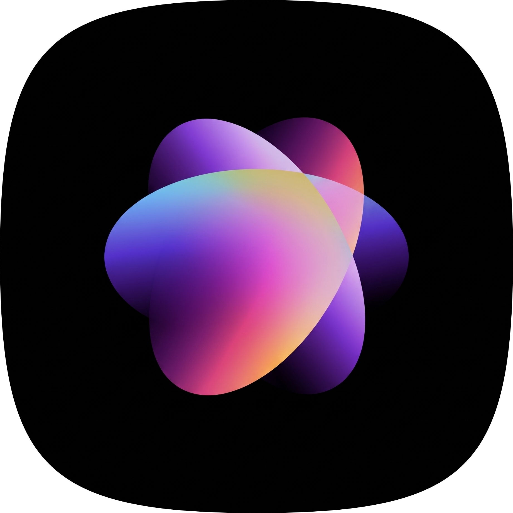

 <p align="center">
  
</p>

<h1 align="center">Halo Desktop</h1>

<p align="center">
  A native Windows media experience, surrounded by light.
</p>

<p align="center">
  <a href="https://github.com/Nox-Wizard-py/Halo-Desktop/releases">Releases</a>
  &nbsp;•&nbsp;
  <a href="https://github.com/Nox-Wizard-py/Halo-Desktop/actions">Builds</a>
  &nbsp;•&nbsp;
  <a href="LICENSE">MIT License</a>
</p>

---

**Halo Desktop** is a lightweight, Windows-native application that transforms your desktop media experience through a custom-rendered media card, ambient edge lighting and carefully crafted visual effects.

Built with modern C++ and native Windows graphics technologies, Halo combines Windows media-session integration, real-time audio processing and GPU-accelerated rendering into a cohesive desktop experience.

From dynamic album artwork and playback controls to reactive Plasma Lighting and frosted-glass materials, every element is designed to feel like a natural extension of the Windows desktop.

> **Project status:** Active development. Features, rendering systems and visual behaviour continue to evolve.

## Features

### Media Card

A floating media interface that integrates directly with Windows media sessions.

- **Media session integration** — Detects and communicates with media sessions through Windows GSMTC.
- **Playback controls** — Play, pause, skip and control supported media sessions.
- **Album artwork** — Displays artwork and metadata from the active media session.
- **Dynamic appearance** — Adapts its visual presentation to the currently playing artwork.
- **Multiple visual materials** — Switch between distinct rendering styles.

### Visual Materials

Three independently designed appearance modes:

| Material          | Description                                                                                           |
| ----------------- | ----------------------------------------------------------------------------------------------------- |
| **Solid**         | A clean, opaque appearance with artwork-derived colours or configurable custom gradients.             |
| **Liquid Glass**  | A glossy, translucent material with optical distortion and glass-like visual effects.                 |
| **Glassmorphism** | A frosted-glass appearance featuring genuine backdrop Gaussian blur, subtle tinting and soft borders. |

### Plasma Lighting

A dynamic screen-edge lighting effect that brings the colours of your currently playing music onto your desktop.

- **Artwork-derived colours** — Extracts a multi-colour palette from album artwork.
- **Perceptual colour extraction** — Uses hue-based clustering and OKLab colour analysis to preserve visually distinct colours.
- **Ambient colour blending** — Distributes dominant and accent colours throughout the plasma effect.
- **Audio reactivity** — Responds to audio through WASAPI loopback capture.
- **Music synchronisation** — Coordinates animation with media playback state.
- **Organic animation** — Features animated startup reveals and continuously evolving lighting.

### Always-On Display

A dedicated fullscreen display mode with multiple presentation options.

- **Black mode** — A minimal black display.
- **Current Wallpaper mode** — Uses the desktop wallpaper as the display background.
- **Wallpaper Engine compatibility considerations** — Designed to coexist with animated desktop backgrounds.
- **Display sleep management** — Prevents unwanted display sleep while AOD is active.
- **Independent controls** — Can be opened and dismissed without terminating Halo.

### Lighting Studio

A dedicated configuration interface for controlling Halo's visual appearance and lighting behaviour.

- Configure Plasma Lighting.
- Adjust Media Card appearance.
- Switch between visual materials.
- Configure Solid material colours.
- Manage visual preferences independently.

### Background Application Lifecycle

Halo is designed to remain available without keeping its visual interfaces permanently open.

- **System tray integration** — Access application controls and visual interfaces from the notification area.
- **Background operation** — Media monitoring and audio services can continue while visual interfaces are hidden.
- **Silent Windows startup** — Supports launching in the background without displaying the Media Card or Plasma.
- **Single-instance enforcement** — Prevents multiple application instances and supports activation of the existing instance.
- **Independent window lifetimes** — Dismissing a visual interface does not terminate the application.
- **Explicit shutdown** — Exit Halo through the system tray's Quit command.

## Technology Stack

Halo Desktop is built using modern C++ and native Windows APIs.

| Technology            | Purpose                                      |
| --------------------- | -------------------------------------------- |
| **C++20**             | Core application implementation              |
| **Win32 API**         | Windows integration and window management    |
| **Direct3D 11**       | GPU-accelerated rendering                    |
| **DirectComposition** | Composited desktop interfaces                |
| **HLSL**              | Custom visual effects and rendering shaders  |
| **WASAPI**            | Audio loopback and audio-reactive processing |
| **GSMTC**             | Windows media-session integration            |
| **CMake**             | Build configuration and project management   |

Halo uses native Windows rendering technologies rather than a browser-based interface or an embedded web application.

## Installation

Prebuilt Windows builds are distributed through GitHub.

**[Download Halo Desktop from Releases](https://github.com/Nox-Wizard-py/Halo-Desktop/releases)**

Available build architectures:

- **Windows x64** — For standard 64-bit Intel and AMD processors.
- **Windows ARM64** — For supported Windows on ARM devices.

Depending on the release, installation packages and portable builds may be available.

### Running from source

You can also build Halo Desktop locally.

## Building from Source

### Requirements

- Windows 10 or Windows 11.
- Visual Studio with the MSVC C++ toolchain.
- Windows SDK.
- CMake.
- Git.

### 1. Clone the repository

```powershell
git clone https://github.com/Nox-Wizard-py/Halo-Desktop.git

cd Halo-Desktop
```

### 2. Configure the project

```powershell
cmake -S . -B build
```

### 3. Build Halo Desktop

```powershell
cmake --build build --config Release
```

The generated build output will be located in the `build` directory.

### Creating installers

Halo Desktop uses Inno Setup 6 for Windows installation packages.

The installer build scripts and configuration are maintained in:

```text
installer/
    HaloDesktop.iss
```

Automated architecture-specific builds are configured through GitHub Actions:

```text
.github/
    workflows/
        build.yml
```

## Project Structure

The repository is organised around the application's native platform, rendering, interface and verification components.

```text
Halo-Desktop/
│
├── src/
│   ├── platform/       # Win32 platform integration
│   ├── render/         # Rendering systems and shaders
│   └── ui/             # Application interfaces
│
├── resources/
│   └── icons/          # Application icons and branding
│
├── tests/              # Automated verification suite
│
├── installer/          # Windows installer configuration
│
├── licenses/           # Third-party licence texts
│
├── .github/
│   └── workflows/      # Automated build workflows
│
├── CMakeLists.txt
├── LICENSE
└── THIRD_PARTY_NOTICES.md
```

## Development

Halo Desktop is actively developed, with an emphasis on:

- Native Windows integration.
- Efficient GPU-accelerated rendering.
- Accurate and visually appealing colour extraction.
- Smooth, responsive visual effects.
- Independent application and interface lifecycles.
- Reliable background operation.
- Maintainable and modular C++ architecture.

The project includes an automated verification suite for testing application functionality, lifecycle behaviour, rendering-related logic and colour extraction.

Contributions, bug reports and technical feedback are welcome.

## License

Halo Desktop's original source code is licensed under the **MIT License**.

Copyright (c) 2026 Nox Wizard.

See the [LICENSE](LICENSE) file for the complete licence.

Some third-party components and referenced material retain their respective licences. See [THIRD_PARTY_NOTICES.md](THIRD_PARTY_NOTICES.md) and the accompanying licence texts for details.

The MIT License does not relicense third-party material or externally sourced artwork.

---

<p align="center">
  Built for Windows. Designed around the experience.
</p>
