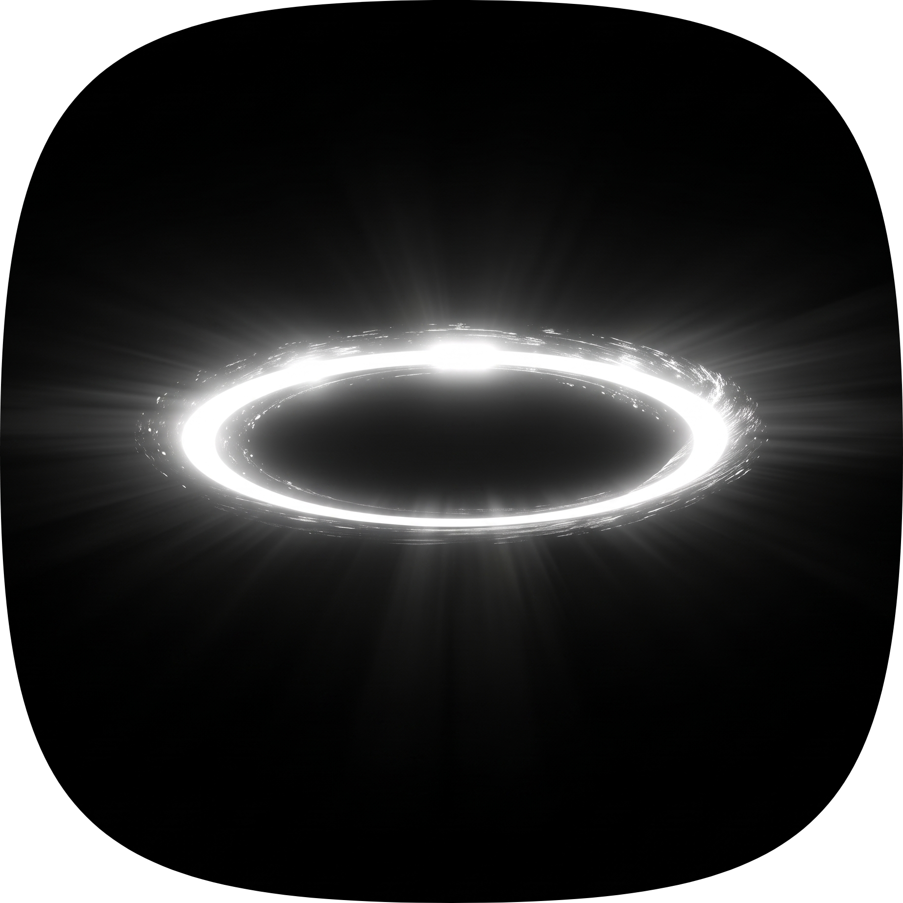

<div align="center">



# Halo Desktop

A native Windows media experience with customizable visual materials.

Halo Desktop is a lightweight, native Windows application designed to bring a polished media experience directly to your desktop. Built with C++20 and native Windows graphics APIs, it combines Windows media-session integration with a custom-rendered interface featuring album artwork, playback controls, advanced glass effects, and audio-reactive lighting.

Designed around visual customization and native performance, Halo Desktop offers three distinct media card materials, an interactive Lighting Studio, and an Always-On Display experience.

</div>

---

# Features

### Media Card

A customizable media card with three distinct rendering materials:

- **Solid** — An opaque material featuring dynamic artwork-derived colours or customizable three-colour gradients. Custom colour presets persist across application restarts.
- **Liquid Glass** — A glossy, optical glass material featuring shader-based refraction and its existing visual effects.
- **Glassmorphism** — A classic frosted-glass material with genuine backdrop blur, neutral charcoal tinting, subtle borders, and soft highlights.

### Windows Media Integration

- **Media session integration** — Connects with Windows media sessions through GSMTC.
- **Playback controls** — Control media playback directly from the card.
- **Album artwork** — Displays artwork associated with the active media session.
- **Media metadata** — Presents information about the currently playing content.

### Lighting Studio

Customize the visual appearance of Halo Desktop through its integrated Lighting Studio.

- **Plasma Lighting** — Animated screen-edge lighting with artwork-derived and customizable colour modes.
- **Artwork colour extraction** — Extracts colours from media artwork to drive visual effects.
- **Custom colour modes** — Personalize the appearance with custom colour selections.
- **Persistent preferences** — Retains supported appearance settings and presets across restarts.

### Always-On Display

A dedicated Always-On Display mode designed to provide a persistent media experience.

- **Black background mode** — Displays the media interface against a black background.
- **Current Wallpaper mode** — Displays the interface over the supported desktop wallpaper background.
- **Media card integration** — Retains the media card and visual effects within the AOD experience.

### Native Rendering

Halo Desktop uses native Windows graphics APIs and custom HLSL shaders to render its interface rather than relying on a browser-based UI or web-rendering framework.

## Technology

Halo Desktop is written in **C++20** and uses:

| Technology        | Purpose                                          |
| ----------------- | ------------------------------------------------ |
| Win32 API         | Native Windows application and window management |
| Direct3D 11       | Hardware-accelerated rendering                   |
| DirectComposition | Desktop visual composition                       |
| HLSL              | Custom rendering shaders and visual effects      |
| WASAPI            | Audio capture and audio-reactive functionality   |
| GSMTC             | Windows media-session integration                |
| CMake             | Build system                                     |

## Rendering Architecture

Halo Desktop uses a custom rendering pipeline built around Direct3D 11 and DirectComposition.

Its media card materials use independent rendering paths:

- **Solid:** Opaque colour-based rendering.
- **Liquid Glass:** Dedicated optical rendering pipeline.
- **Glassmorphism:** A two-pass separable Gaussian blur pipeline.

The Glassmorphism implementation uses horizontal and vertical Gaussian convolution, downsampled intermediate textures, and bilinear tap pairing to produce a continuous frosted-glass backdrop effect.

The Gaussian blur implementation is exclusive to Glassmorphism and does not replace or modify the Liquid Glass rendering pipeline.

## Building

Halo Desktop is a Windows-native project.

### Requirements

- Windows 10 or Windows 11
- Visual Studio with the MSVC C++ toolchain
- Windows SDK
- CMake

### Build from Source

Clone the repository:

```powershell
git clone https://github.com/Nox-Wizard-py/Halo-Desktop.git
cd Halo-Desktop
```

Configure the project:

```powershell
cmake -S . -B build
```

Build the application:

```powershell
cmake --build build --config Release
```

The generated build output will be located in the `build` directory.

### Verification

The project includes an automated verification suite.

Run the verification executable after building:

```powershell
.\build\LumnVerification.exe
```

The verification suite includes rendering and shader compilation checks, including Glassmorphism and Liquid Glass regression tests.

## Project Status

**Version:** 1.0.0

Halo Desktop has reached its first stable release milestone, bringing together its core media experience, three customizable rendering materials, Lighting Studio, Plasma Lighting, and Always-On Display functionality.

Future development will continue to refine rendering quality, performance, stability, and the overall desktop experience.

## License

No license has been added yet. Until a license is provided, the source code is not granted permission for reuse, redistribution, or modification.

---

<div align="center">

<h4>Built with ❤️ by <a href="https://t.me/offxe_shoyo">Nox Wizard</a></h4>

</div>
